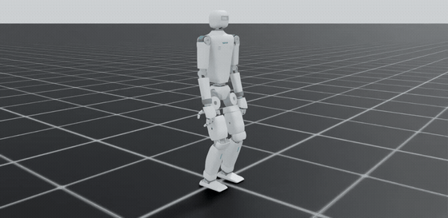
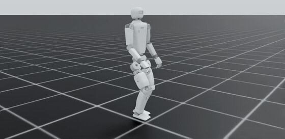
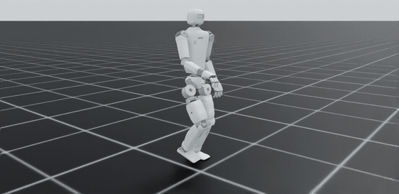
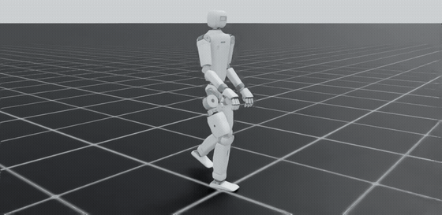
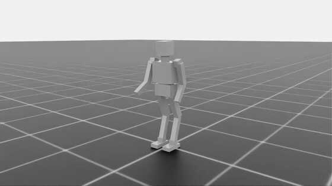
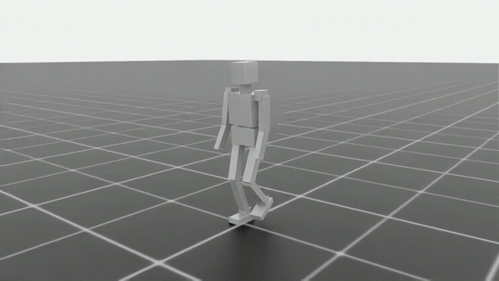
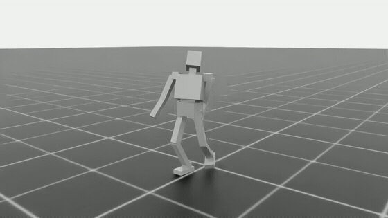
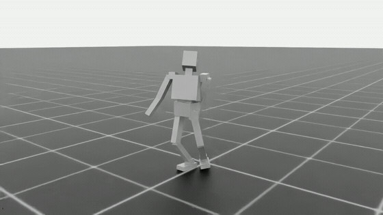

This is a repository that contains all the training I have done for a humanoid robot my and my friend are building. I’m currently working on using reinforcement learning in ISAAC lab to train it digitally and in the future we will have a real live demo ready.

here are a few gif videos of the robotcs i've trained.

Humanoid robot training for my current revision of robot, spanning different policies such as walking, standing, running

Humanoid robot training for my previous iteration of robot:

